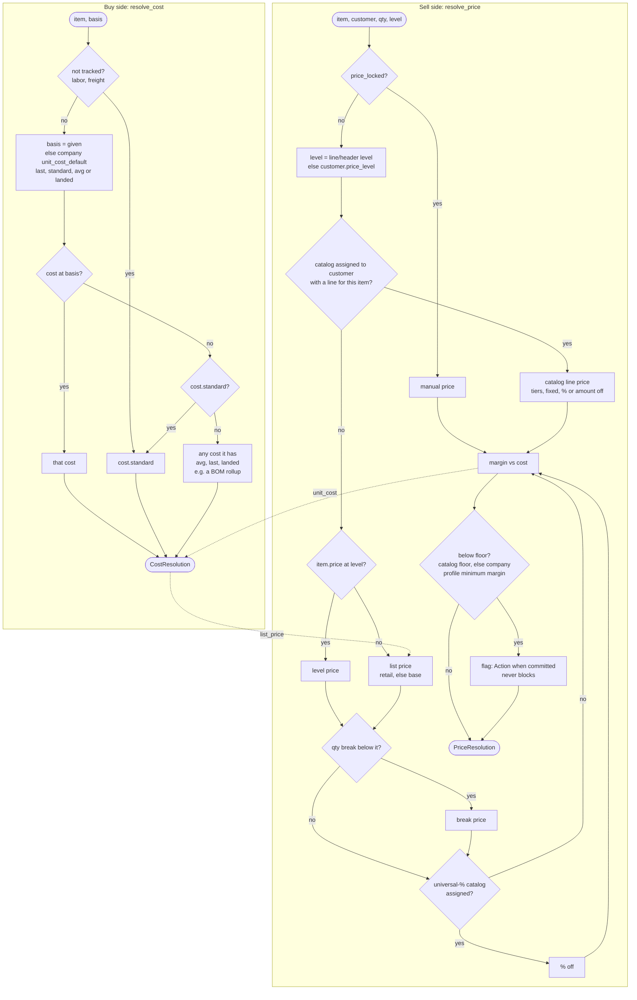

# Pricing and Costing — One Behavior Each
**Rebuilt:** 2026-10-22 (Bill: "Merge into one behavior … these should reference each other
so users can see control.") | **Code:** `apps/products/services/price_resolver.py`

---

## The rule

There is **one** sell-side pricing behavior, `resolve_price()`, and **one** buy-side
costing behavior, `resolve_cost()`. Each result names the other's figure:

| | Answers | Carries the other side's figure |
|---|---|---|
| `resolve_price(item, customer_id, qty, level)` → `PriceResolution` | What does this customer pay? | `unit_cost`, `cost_basis`, `margin_pct`, `margin_floor`, `below_margin_floor` |
| `resolve_cost(item, basis)` → `CostResolution` | What does a new line cost us? | `list_price`, `margin_pct` (left at list) |

The browser never chooses a price level or a cost basis. It asks: manage action
`price_lines` returns both figures per item, and the screens show them. The other side's
figure is in the tooltip on the value, so a seller sees the cost under the price and a
buyer sees the price over the cost.

The rule for what folds in is about behavior, not files. Code that **chooses** a cost basis
or a price goes through these two functions. Code that only **reads** an actual stays a
reader: inventory layers (FIFO/LIFO/avg valuation), landed cost on receipts, COGS, and the
average cost in margin velocity.

---

## Flowchart

---

## Sell side in detail

1. **price_locked** — a manual price on the line. Nothing else runs.
2. **Catalog line** — catalogs that are active, inside their dates, and **assigned to this
   customer**, highest priority first. Assigned means `customer_orgbase` is the customer,
   or `applies_to` holds `all: true`, the customer's id in `customers`, or the customer's
   level in `price_levels`. A catalog assigned to no one prices for no one; a vendor's
   catalog is not a customer's price list. The line matches the item directly, then by
   scope (`all_items`, `categories`, `vendors`), within its `min_qty`/`max_qty`. Its price
   comes from `items.pricing.tiers` by quantity if present, else its adjustment:
   `fixed_price`, or `percent_off`/`amount_off` taken off the line's `price_unit` or the
   level price.
3. **Price level** — the level is the line's, else the header's, else the customer's.
   `item.price[level]`. A level with no price sells at list.
   - **Quantity break** — `item.price.qty_breaks` is `{min_qty, unit_price}` or
     `{min_qty, variant_item_id}` (Item.save keeps only those keys). The highest break
     the quantity reaches applies **when it is lower** than the level price. A break
     never raises a customer's price.
   - **Universal %** — a universal-% catalog assigned to the customer comes off last.
4. **List price** — `item.price.retail`, else `item.price.base`.

**Margin** is on price: `(price − cost) / price`. The floor is the catalog's
`margin_floor`, else the company profile's `config.pricing.minimum_margin` (15 when
unset). A floor of 0 still flags a sale below cost.
`resolve_price` never writes. The callers that commit a price (portal order save, wcapi
order, `apply_line_pricing`) call `flag_below_margin()`, which writes an informational
Action. Shipment is never blocked.

## Buy side in detail

- A **not-tracked** item (labor, freight) is its `cost.standard` rate.
- Otherwise the basis given, else the company profile `inventory.unit_cost_default`
  (`last` when missing). An item with nothing at that basis falls to `standard`, since a
  new item has a standard cost before it has ever been bought. Then it falls to any cost
  it has (avg, last, landed), because a built item's BOM rollup lands in `cost.avg` and a
  figure on the item should never be priced as zero. With nothing at all the cost is 0
  and the basis is `none`. A BOM rollup reads that as "missing", not as zero.
- `costing_method` (FIFO/LIFO/avg) is a different question. It values COGS from the
  layers and is not a cost pick.

## Price levels

**retail, wholesale, distributor, sample** are the only levels (Bill, 2026-10-22). They are
the `Item.price` keys. A save of any other value on an org, header or line is refused
naming the four (`save._price_level_is_named`, the `invalid_terms` pattern). One in
another case is stored lowercase. Migration `transactions/0052_price_level_words`
rewrote the letters and case variants already stored.

---

## Who calls what

| Caller | Calls |
|---|---|
| Staff line card, adding a line (`LineCardRenderer.tsx`) | `price_lines` → both figures at the line's quantity |
| Staff item search, result column and tooltip (`TransactionItemSearch.tsx`) | `price_lines` for the results |
| Portal order save (`core/services/save.py` `_portal_priced_lines`) | `resolve_price` + `flag_below_margin` |
| wcapi order (`transactions/views/wcapi.py`) | `resolve_price` + `flag_below_margin` |
| Clone, repricing a line (`record_clone.py` → `apply_line_pricing`) | `resolve_price` + `flag_below_margin` |
| Server line service (`line_manage.LineItemService`) | `resolve_price` / `resolve_cost` when no explicit figure |
| Convert order→purchase, purchase→receipt (`convert.py`) | `resolve_cost` |
| BOM component cost (`component_unit_cost`) | `resolve_cost` |
| BOM tree, user-chosen basis (`bom_ops.expand_tree`, BOMPanel) | `resolve_cost(basis=…)`; `min` = lower of avg and last |
| Inventory report, movement without a layer actual (`report_executors.py`) | `resolve_cost` |
| Reorder bounds margin (`inventory_bounds.py`) | `resolve_cost().margin_pct` |
| Margin velocity (`inventory_layers.py`) | `list_price` (cost stays the layers' avg actual) |
| Training flow | `resolve_price` / `resolve_cost` |
| Portal catalog page (`portal/js/views/customer/catalog.js`) | shows the one level price the server serves (`price.$user.price_level`); the order is priced on save |

Manage actions: `price_lines`, `resolve_price`, `resolve_cost`, `get_price_matrix`,
`apply_line_pricing`.

Out of scope: JPods ticketing (`apps/jpods/services/pricing.py`, its own fare levels).

---

## Alice coaching

Seeded by `seed_coaching` (tips `cust-03/04`, `ord-03/04`, `po-03/04`, `item-03/04`, the
`price_level` field help, and the "Pricing Architecture" document). What Alice says:

- *Price levels are retail, wholesale, distributor, sample — the only four. The customer's
  level prices every line unless the document or line names another.*
- *A catalog is a customer's price list. Assign it, and its prices beat the level for the
  items it lists. A catalog assigned to no one prices for no one.*
- *Hover a price: it names how it was reached, the cost under it, and the margin. That is
  your control.*
- *Below the margin floor is a flag, not a stop. It saves and ships, and an Action asks
  whether the price was meant.*
- *A new purchase line starts at the company cost basis. With nothing there it starts at
  standard; labor and freight are always their standard rate.*
- *Hover a cost: it names the list price it feeds and the margin left at list.*
- *Quantity breaks only lower a price.*

---

## What changed (2026-10-22)

Seven sales paths and eight cost pickers became two functions. Gone:
`resolve_price_legacy`, `get_price_for_line`, `resolve_price_level`, `resolve_unit_price`,
the `_legacy_*` catalog helpers, `inventory_layers.item_unit_cost`/`get_unit_cost_default`,
the browser's `resolveUnitPrice`/`resolveUnitCost`, `LineItemService.addItem` (frontend),
and the item-picking in `line_manage`, `training_flow`, `report_executors` and the BOM.

Behavior changes to know:
- **Staff lines now get catalogs, quantity breaks and the customer's level.** Before,
  the browser priced them, and item search ignored the level entirely.
- **An unassigned catalog no longer applies to everyone.**
- **Margin is on price everywhere.** One path used markup on cost.
- **A quantity break no longer overrides a catalog price** and never raises a price.
- **BOM component cost uses the company basis** (was avg → standard → last → landed);
  the BOM tree's chosen basis falls to standard, then any cost (was: to avg).
